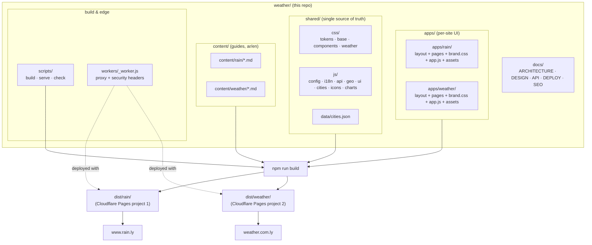

# Rain.ly + weather.com.ly

One repository, two meteorological products, zero API keys.

This repo unifies **[Rain.ly](https://www.rain.ly/)** (precipitation intelligence & rain radar) and **[weather.com.ly](https://weather.com.ly/)** (weather, air quality, marine state, and earthquake observatory) into a single, maintainable codebase. Both sites share the same design system, data layer, and build pipeline, but deploy as **two separate Cloudflare Pages projects** with distinct branding and content.

- **Runtime:** plain HTML/CSS/JS — no npm runtime dependencies
- **Design:** shadcn/ui v4 visual language recreated in CSS (oklch tokens, restrained radii/elevation)
- **Languages:** Arabic + English with browser-language auto-detection, RTL, and a persisted manual toggle
- **Data:** free, keyless open APIs (Open-Meteo, RainViewer, USGS, OSM/CARTO, BigDataCloud, ipwho.is, wttr.in fallback)

## Repository map



## What each site provides

| | Rain.ly | weather.com.ly |
|---|---|---|
| Focus | Precipitation intelligence | Meteorological observatory |
| Brand | Dark-first azure | Light-first teal |
| Core | Current conditions, hourly rain probability, 7-day accumulation | Current conditions, 7-day forecast |
| Maps | RainViewer composite radar with timeline | Location map with USGS earthquake layer |
| Extra | Rain totals, wet days, radar nowcast | Air quality (AQI/PM/dust), marine state, sunrise arc, earthquakes |
| SEO | Per-city pages, guides, sitemap, structured data | Per-city pages, guides, sitemap, structured data |

## Quick start

Requirements: **Node.js >= 18** (no `npm install` needed).

```bash
# build both sites into dist/rain and dist/weather
npm run build

# validate output (links/assets, JS syntax, i18n keys, required files)
npm run check

# serve locally (separate ports because asset paths are root-absolute)
npm run serve
# rain.ly        -> http://127.0.0.1:8788/
# weather.com.ly -> http://127.0.0.1:8789/

# build + check
npm run verify
```

## How the build works

`scripts/build.mjs` produces two fully self-contained static sites:

1. Copies `shared/css`, `shared/js`, and `shared/data/cities.json` into each `dist/<site>/assets/`.
2. Copies site-specific `brand.css`, `app.js`, and `assets/` (favicon, OG image).
3. Renders every page by injecting `apps/<site>/pages/*.html` into `apps/<site>/layout.html` with `{{placeholders}}`.
4. Generates `index`, `about`, `guides`, `cities`, `404`, one page per Libyan city (`city/<id>.html`), and one page per guide (`guides/<slug>.html`, with Arabic/English content toggled by language).
5. Emits `robots.txt`, `sitemap.xml`, and basic `_headers` for each site.

## Project structure

```
.
├─ apps/
│  ├─ rain/                 # Rain.ly layout, pages, brand.css, app.js, assets
│  └─ weather/              # weather.com.ly layout, pages, brand.css, app.js, assets
├─ shared/
│  ├─ css/                  # shadcn tokens + base + components + weather primitives
│  ├─ js/                   # config, i18n, api, geo, ui, cities, icons, charts
│  └─ data/cities.json      # Libyan + world cities and climate zone text
├─ content/
│  ├─ rain/                 # guide markdown (ar/en)
│  └─ weather/              # guide markdown (ar/en)
├─ workers/_worker.js       # Cloudflare Pages worker: /api/fetch proxy + security headers
├─ scripts/                 # build.mjs, serve.mjs, check.mjs
├─ docs/                    # architecture, design, API, deploy, SEO
└─ dist/                    # build output (gitignored)
```

## Internationalization

- Auto-detects from `navigator.languages` (`ar*` → Arabic/RTL), with a stored preference (`wx.lang`) taking priority.
- `shared/js/i18n.js` holds the UI dictionary, WMO code labels, formatting (Arabic uses `ar-LY-u-nu-latn` numerals), and direction handling.
- Guide pages ship both languages and show the active one client-side.

## Security & privacy notes

- No API keys, no accounts, no advertising SDKs, no third-party trackers. Preferences are stored locally in the browser.
- The Cloudflare Worker (`workers/_worker.js`) exposes an allowlisted same-origin proxy (`/api/fetch`) and sets security headers/CSP appropriate for the data sources and Leaflet/Google Fonts assets used.
- **Operational note:** a previously exposed OpenWeatherMap key associated with the old Blogger deployment must be revoked/rotated at the provider; this repository does not use it.

## Deployment

Deploy `dist/rain` and `dist/weather` as **two separate Cloudflare Pages projects** (see [`docs/DEPLOY.md`](docs/DEPLOY.md)). Each project can include the worker for the proxy/headers behavior.

## Documentation

- [`docs/ARCHITECTURE.md`](docs/ARCHITECTURE.md) — system layout and data flow
- [`docs/DESIGN.md`](docs/DESIGN.md) — shadcn token mapping and brand theming
- [`docs/API.md`](docs/API.md) — data sources, endpoints, and caching
- [`docs/DEPLOY.md`](docs/DEPLOY.md) — Cloudflare Pages + worker setup
- [`docs/SEO.md`](docs/SEO.md) — per-city pages, guides, sitemap, structured data

## License

MIT — see [LICENSE](LICENSE).
