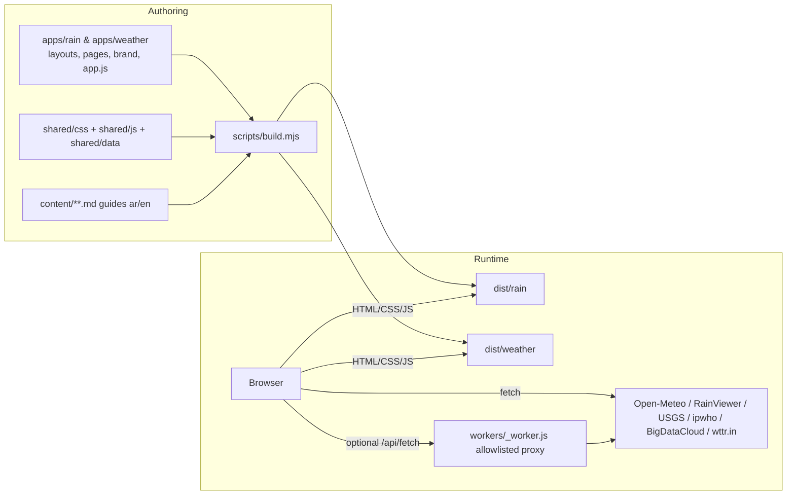
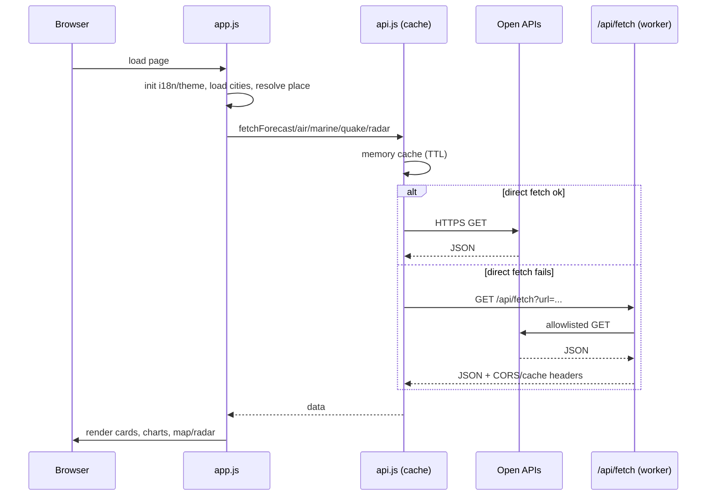

# Architecture

## Goals

- One repo, two independently deployable products (`www.rain.ly`, `weather.com.ly`).
- Shared, framework-free runtime (plain HTML/CSS/JS, ES modules) with a single design/data layer.
- Free, keyless data sources with graceful fallbacks and client-side caching.
- Bilingual (Arabic/English) UX with RTL support and per-city/guide SEO pages.

## High-level layout

## Source layers

### `shared/`
- **`css/tokens.css`** — shadcn/ui v4 oklch tokens (verbatim mapping) plus `[data-brand="rain|weather"]` overrides for `--primary`, accents and charts. Single source of colour.
- **`css/base.css`** — reset, typography (Geist + IBM Plex Sans Arabic), logical-property layout primitives and utilities (RTL-safe).
- **`css/components.css`** — shadcn-style primitives (`.btn`, `.card`, `.tabs`, `.badge`, `.input`, `.table`, `.dialog/.modal`, `.sheet`, `.toast`, `.skeleton`, etc.).
- **`css/weather.css`** — domain components (hero/current card, metric grid, hourly strip, daily rows, map/radar shell, gauges, sun arc, detail grid, prose, footer).
- **`js/config.js`** — site metadata, API endpoints, defaults (Tripoli), tile URLs, storage keys, cache TTLs.
- **`js/i18n.js`** — dictionary (ar/en), language detection/persistence, RTL toggling, WMO codes/labels, formatters and unit helpers. No DOM access at import time.
- **`js/api.js`** — cached `fetch` with timeout, endpoint helpers (forecast/air/marine/quake/radar/geocode/reverse/ip/wttr), multi-city batch, and optional proxy fallback.
- **`js/geo.js`** — place normalization/persistence, browser geolocation, IP/reverse fallbacks.
- **`js/ui.js`** — DOM helpers, toasts, dialogs, tabs, sheet, share/copy, rain canvas.
- **`js/cities.js`** — city catalog loading/search/nearest/zone helpers.
- **`js/icons.js`**, **`js/charts.js`** — inline SVG UI icons/weather glyphs and dependency-free SVG charts.
- **`js/theme-init.js`** — synchronous head script to apply stored/system/brand-default theme before paint.
- **`data/cities.json`** — Libyan cities (with zone/region/coords), world cities, and zone climate text.

### `apps/<site>/`
- `layout.html` — HTML shell with `{{head}}`, `{{body}}`, nav/footer, search dialog and sheet.
- `pages/*.html` — page bodies injected into the layout (`index`, `about`, `guides`, `cities`, `city`, `guide`, `404`).
- `brand.css` — site-specific brand tweaks layered over shared tokens.
- `app.js` — page bootstrap, data loading/rendering, maps/radar, search and interactions.
- `assets/` — favicon and Open Graph image.

### `content/<site>/`
Markdown guides with simple front matter (`slug`, `lang`, `title`, `description`, `date`, `read`). The build converts a small Markdown subset to HTML and emits a combined `guides/<slug>.html` page containing both languages (toggled client-side).

## Build & output

`scripts/build.mjs`:
- Renders pages from layout + page templates with placeholder substitution and generated head/meta tags.
- Produces per-city pages for all Libyan cities and per-guide pages per site.
- Writes `robots.txt`, `sitemap.xml`, and `_headers` per site.
- Copies the worker is not automatic at build time; deploy it with each Pages project as configured.

`scripts/check.mjs` validates: required files, `node --check` for JS, broken internal `/...` href/src references, and that `data-i18n*` keys exist in `i18n.js`.

`scripts/serve.mjs` serves `dist/rain` (8788) and `dist/weather` (8789) locally.

## Runtime data flow

## Edge/worker

`workers/_worker.js` (Cloudflare Pages Advanced Mode): serves static assets via `env.ASSETS`, proxies only allowlisted upstream origins through `/api/fetch`, strips cookies, adds CORS/cache for proxied responses, and applies baseline security headers/CSP.

## Extensibility notes

- New data source: add endpoint to `shared/js/config.js`, helper in `shared/js/api.js`, allowlist entry + CSP connect-src in the worker.
- New city: append to `shared/data/cities.json` (rebuilt into per-city pages).
- New guide: add `content/<site>/<slug>.<lang>.md` and a card/link in the site's guides index page.
